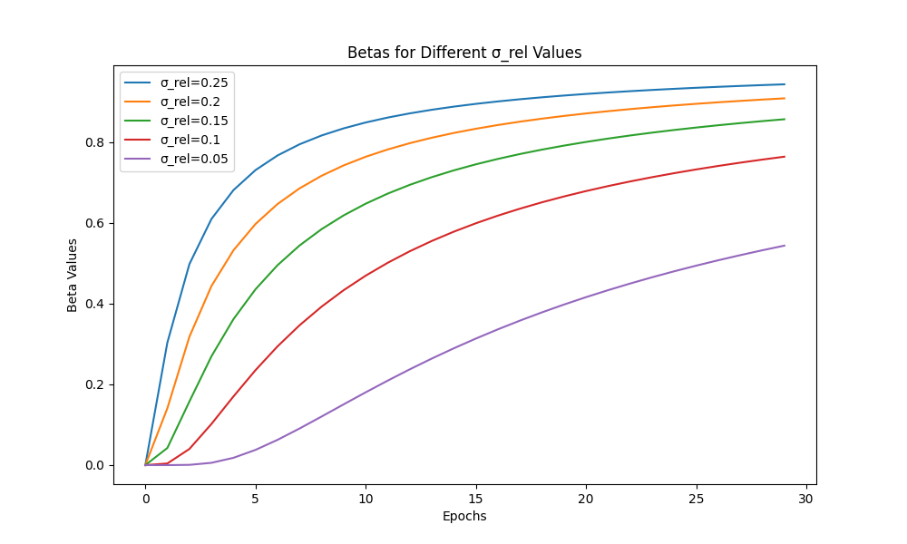

# LoRA Post-Hoc EMA Merging / LoRAのPost-Hoc EMAマージ

## Overview / 概要

`networks/lora_post_hoc_ema.py` combines several LoRA checkpoints of **one training run** into a single LoRA with an exponential moving average (EMA) over the checkpoints. The weights at the end of a training fluctuate from step to step; averaging the checkpoints saved near the end reduces this fluctuation, and the result may be more stable than the last checkpoint. Because the average is taken after the training ("post-hoc"), the training itself is not changed and several settings can be compared with the same checkpoints.

The script is ported from [Musubi Tuner](https://github.com/kohya-ss/musubi-tuner/blob/main/docs/tools.md). It needs only the checkpoint files (no base model, no GPU).

The script works as follows:

1. Sort the checkpoint files by modification time (oldest to newest).
2. Use the oldest checkpoint as the base.
3. Merge the following checkpoints one by one with a decay rate (beta).

```
merged_weights = checkpoints[0]
for checkpoint in checkpoints[1:]:
    merged_weights = beta * merged_weights + (1 - beta) * checkpoint
```

Save the checkpoints during the training with `--save_every_n_epochs` or `--save_every_n_steps`.

`networks/lora_post_hoc_ema.py` は、**同じ学習**の複数の LoRA チェックポイントを、指数移動平均（EMA）で 1 つの LoRA にまとめます。学習終盤の重みはステップごとに揺れているため、終盤に保存したチェックポイントを平均するとこの揺れが減り、最後のチェックポイントより安定した結果になることがあります。平均は学習後に取る（post-hoc）ので、学習そのものは変わらず、同じチェックポイントで複数の設定を比較できます。

このスクリプトは [Musubi Tuner](https://github.com/kohya-ss/musubi-tuner/blob/main/docs/tools.md) から移植したものです。必要なのはチェックポイントのファイルだけです（ベースモデルや GPU は不要です）。

スクリプトは次のように動作します。

1. チェックポイントのファイルを更新時刻でソートします（古い順）。
2. 最も古いチェックポイントをベースにします。
3. 以降のチェックポイントを、減衰率（beta）で 1 つずつマージします。

学習中のチェックポイントは `--save_every_n_epochs` または `--save_every_n_steps` で保存してください。

## Usage / 使い方

```bash
python networks/lora_post_hoc_ema.py \
    my_lora-000016.safetensors my_lora-000018.safetensors my_lora-000020.safetensors \
    --output_file my_lora_ema.safetensors --beta 0.9
```

Options:

- `path [path ...]`: The LoRA checkpoint files to merge. Wildcards are expanded by the shell on Linux / macOS; on Windows, list the files explicitly.
- `--output_file`: Output file (required).
- `--beta`: Decay rate (default: 0.95). A higher value gives more weight to the older checkpoints, a lower value to the newer ones.
- `--beta2`: If specified, the decay rate is linearly interpolated from `--beta` (at the second file) to `--beta2` (at the last file).
- `--sigma_rel`: Use the Power Function EMA of [the EDM2 paper](https://arxiv.org/abs/2312.02696) instead of a fixed beta. `--beta` and `--beta2` are ignored.
- `--no_sort`: Do not sort the files by modification time; merge them in the order of the command line.

オプション:

- `path [path ...]`: マージする LoRA チェックポイントのファイル。ワイルドカードは Linux / macOS ではシェルが展開します。Windows ではファイルを個別に指定してください。
- `--output_file`: 出力ファイル（必須）。
- `--beta`: 減衰率（デフォルト 0.95）。大きいほど古いチェックポイントの比重が、小さいほど新しいチェックポイントの比重が大きくなります。
- `--beta2`: 指定すると、減衰率を `--beta`（2 番目のファイル）から `--beta2`（最後のファイル）へ線形補間します。
- `--sigma_rel`: 固定の beta の代わりに、[EDM2 の論文](https://arxiv.org/abs/2312.02696)の Power Function EMA を使います。`--beta` と `--beta2` は無視されます。
- `--no_sort`: ファイルを更新時刻でソートせず、コマンドラインで指定した順にマージします。

## Choosing the Files and the Decay Rate / ファイルと減衰率の選び方

### With `--beta` / `--beta` を使う場合

Specify only the checkpoints of the part of the training you want to average (for example the last quarter), not all checkpoints.

Note that the first file is used as the base, so its weight in the result is `beta ^ (number of files - 1)`, which is large when the number of files is small:

| Number of files | beta 0.8 | beta 0.9 | beta 0.95 |
|---|---|---|---|
| 4 | 0.51 | 0.73 | 0.86 |
| 8 | 0.21 | 0.48 | 0.70 |
| 16 | 0.04 | 0.21 | 0.46 |

For example, with 4 files and `--beta 0.9`, 73% of the result is the oldest of the four checkpoints. This is not a problem as long as all the specified checkpoints are from the part where the training has almost converged, but do not include early checkpoints. With a small number of files, use a lower beta or `--sigma_rel`.

平均したい区間（例えば学習の最後の 1/4）のチェックポイントだけを指定してください。すべてのチェックポイントを指定するのではありません。

最初のファイルがベースになるため、結果に占める最初のファイルの重みは `beta ^ (ファイル数 - 1)` になり、ファイル数が少ないと大きくなる点に注意してください（上の表）。

例えば 4 ファイルで `--beta 0.9` の場合、結果の 73% は 4 つのうち最も古いチェックポイントです。指定したチェックポイントがすべて、学習がほぼ収束した区間のものであれば問題ありませんが、序盤のチェックポイントは含めないでください。ファイル数が少ないときは、beta を小さくするか `--sigma_rel` を使ってください。

### With `--sigma_rel` / `--sigma_rel` を使う場合

With `--sigma_rel`, beta starts from 0 and increases with the number of merged files, so the first file does not have a disproportionately large weight. The weight of a checkpoint grows with its position in the list, and a larger `sigma_rel` gives more weight to the older checkpoints (a wider average). All checkpoints of the training can be specified; `--sigma_rel 0.2` is a starting point, and values from 0.05 to 0.25 are worth trying.



`--sigma_rel` を使うと、beta は 0 から始まりマージしたファイル数に応じて大きくなるため、最初のファイルの重みが不釣り合いに大きくなることはありません。チェックポイントの重みは並び順が後ろのものほど大きく、`sigma_rel` が大きいほど古いチェックポイントの比重が増えます（広い範囲の平均になります）。学習のすべてのチェックポイントを指定してかまいません。`--sigma_rel 0.2` を出発点に、0.05 から 0.25 程度の値を試してみてください。

The best setting depends on the model, the dataset and the training settings. Try several values and compare the generated images.

最適な設定はモデル、データセット、学習設定によって変わります。複数の値を試して、生成画像を比較してください。

## Notes / 注意点

- All files must be checkpoints of the same training run, with the same keys, shapes and alpha. Files of different trainings can be merged if the shapes match, but the result is not meaningful as Post-Hoc EMA.
- The files are sorted by modification time. If the modification times are not in the order of the training (for example, after the files were copied), specify the files in the order of the training with `--no_sort`.
- `lora_up` and `lora_down` are averaged separately (the product `lora_up × lora_down` is not averaged). For checkpoints near the end of a training, the difference is small.
- The merge is calculated in float32, and the result is saved in the data type of the first file.
- The metadata is taken from the last file, and only the hash values are recalculated.

- すべてのファイルは同じ学習のチェックポイントで、キー、形状、alpha が同じである必要があります。別の学習のファイルも形状が合えばマージできますが、Post-Hoc EMA としては意味のある結果になりません。
- ファイルは更新時刻でソートされます。更新時刻が学習の順になっていない場合（ファイルをコピーした後など）は、`--no_sort` を付けて学習の順にファイルを指定してください。
- `lora_up` と `lora_down` は別々に平均します（積 `lora_up × lora_down` の平均ではありません）。学習終盤のチェックポイントでは、その差は小さくなります。
- マージは float32 で計算し、結果は最初のファイルのデータ型で保存します。
- メタデータは最後のファイルのものを使い、ハッシュ値だけを再計算します。
